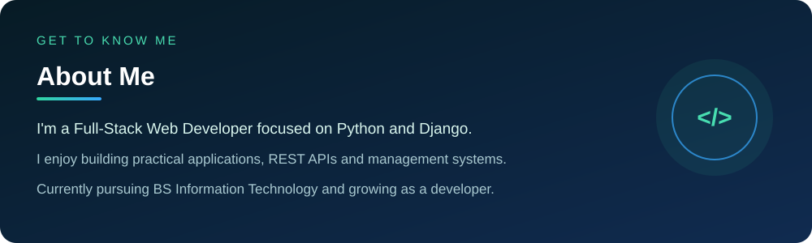
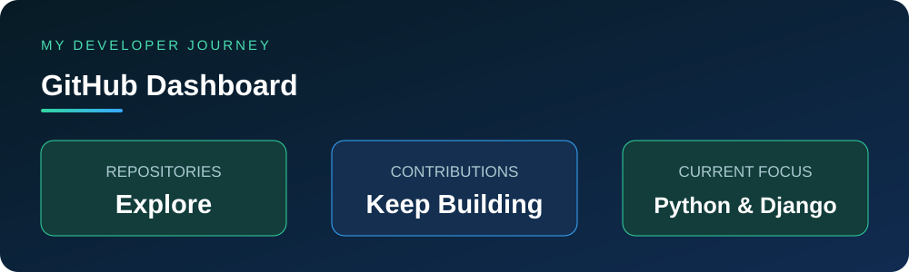

## 🚀 Things I've Built

| Project | What it does | Focus |
|---|---|---|
| **Shop / POS Management System** | Product, inventory and sales management | Django + POS |
| **Restaurant Management System** | Restaurant and order management | Full Stack |
| **Software House Training Institute Management System** | Employee, training and course management | Django + REST API |
| **Student Showcase Platform** | Students showcase and share their projects | Django + DRF |

## 🌐 Connect With Me

**Curious by default. Building with intent. 💚**

